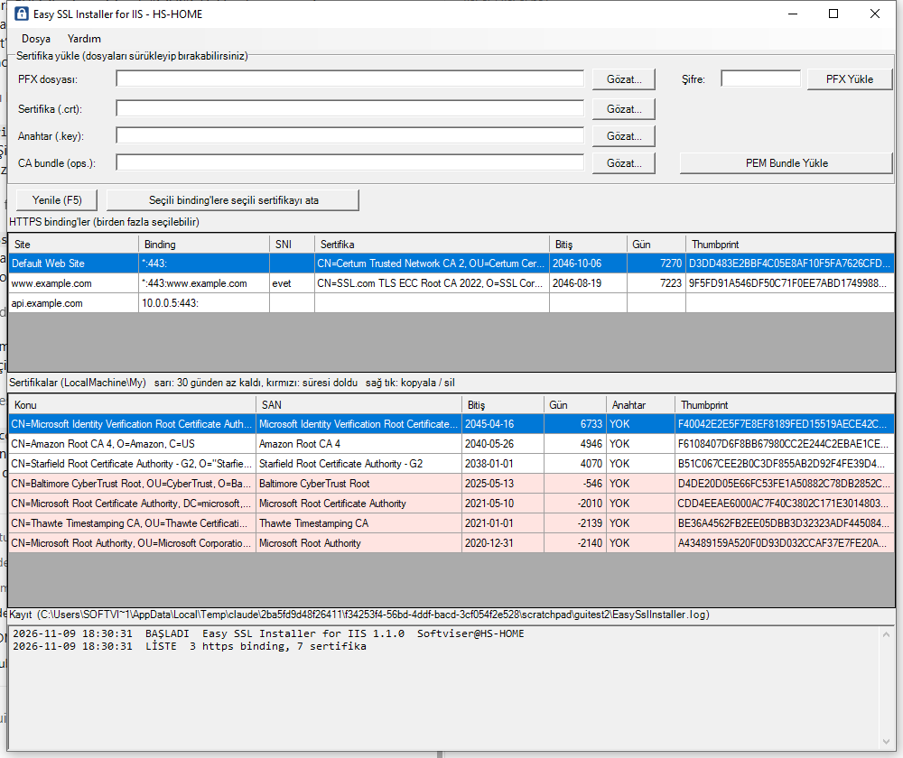

# Easy SSL Installer for IIS

A small Windows tool that installs SSL certificates into IIS and updates HTTPS bindings from one window.
No installer, no runtime to download: it is a single PowerShell 5.1 / WinForms script, also shipped as a
self-contained `EasySslInstaller.exe`. Works on any Windows or Windows Server with IIS.



## What it does

- Lists every HTTPS binding (site, IP:port:host, SNI, bound certificate, expiry, days left).
- Lists the certificates in `LocalMachine\My` with SAN names, expiry, days left and whether a private key is present.
  Rows turn yellow under 30 days and red when expired.
- Imports a PFX / P12 file with its password.
- Imports a PEM bundle: certificate (.crt) + private key (.key) + optional CA bundle. The conversion to PFX is done
  with Windows' own `certutil`, so OpenSSL is not needed. The CA bundle goes into the Intermediate Certification
  Authorities store.
- Assigns the selected certificate to one or more selected bindings. For a renewal: select every binding that uses the
  old certificate, select the new one, assign.
- Right-click a certificate to copy its thumbprint or delete it (refused while a binding still uses it).
- Logs every action (imports, conversions, CA store additions, binding changes with old and new thumbprint, errors)
  to the panel at the bottom and to `EasySslInstaller.log` next to the executable.

## Usage

Download `EasySslInstaller.exe` from the Releases page and run it. It asks for administrator rights.

Or run the script directly: double-click `EasySslInstaller.cmd` (it elevates itself).

## Building the exe

```
powershell -ExecutionPolicy Bypass -File build.ps1
```

`build.ps1` uses the C# compiler that ships with the .NET Framework (`csc.exe`) to compile `Host.cs` with
`EasySslInstaller.ps1` embedded as a resource. Nothing to install. The icon is generated by `make-icon.ps1` when
`EasySslInstaller.ico` is missing.

## Notes

- Encrypted private keys are not supported; remove the passphrase first.
- The exe is not code-signed. If an antivirus objects, run `EasySslInstaller.cmd` instead.
- Requires Windows PowerShell 5.1 and the IIS `WebAdministration` module (present on every IIS install).

## License

MIT. Copyright (c) 2026 [Softviser Yazılım](https://www.softviser.com.tr).

---

## Türkçe

IIS üzerine SSL sertifikası yükleyen, mevcut sertifikaları ve HTTPS binding'leri gösteren, yenileme sırasında
binding'leri yeni sertifikaya geçiren küçük bir araç. Kurulum yok; tek bir PowerShell betiği ve onu gömülü taşıyan
`EasySslInstaller.exe`.

- PFX veya PEM bundle (crt + key + ca-bundle) yükler. PEM dönüşümü `certutil` ile yapılır, OpenSSL gerekmez.
- Üstte binding'ler, altta sertifikalar; 30 günden az kalanlar sarı, süresi dolanlar kırmızı.
- Birden fazla binding seçip tek seferde yeni sertifikayı atayabilirsiniz.
- Sağ tık: thumbprint kopyala, sertifikayı sil (bir binding kullanıyorsa silmez).
- Her işlem alttaki kayıt paneline ve exe'nin yanındaki `EasySslInstaller.log` dosyasına yazılır.

Exe'yi Releases sayfasından indirip çalıştırın (yönetici yetkisi ister) ya da `EasySslInstaller.cmd` ile betiği
doğrudan açın. Exe'yi yeniden üretmek için `build.ps1` çalıştırın; ek kurulum gerekmez.
